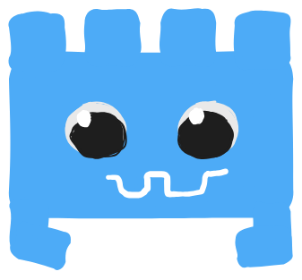

	
	<h3>Rich Presence Using Godot (RPUG)</h3>

Parent Repository: Godot 4.6.X Minimal Template (v0.2.0) 
Version: 0.1.0 
Supported Engine Version: [4.7.2] 
Project Development Started: 2026-10-20 
Version Development Started: 2026-10-20 
Prepared by: [Robert Sardilla] 
 
This project was inspired by CustomRP by maximmax42. 

## Getting started
First, this app requires discord app to be present in your desktop.

The second step is to grab your copy from [Releases](https://github.com/kinaban/rich-presence-using-godot/releases) and select the latest stable version available for your Operating System.

The third step is to configure this app to your liking using the following guide:
1. App ID: This can be generated through [Discord's Developer Portal](https://discord.com/developers/applications), and using the Application ID to configure the app.
2. App Name: This will supersede the name you've given your app in the developer portal, and is useful if you want to reuse the same app id for different games.
3. Process (Optional): By default this will make this app show presence when enabled without having to detect any app, but, by selecting from the list of currently running apps in your desktop, the app would only show presence when it detects your target program.
4. Details: This usually describes what are you mainly doing in the game or app, like "Playing Skywars".
5. State: This usually represents the status of your game like "Waiting for friends".
6. Large Image: This can be a url of an image or a gif you've found from the internet, or you can also use the icons you've configured in your discord app.
7. Small Image: The same with large image but appears as a secondary small icon on the bottom right.
8. Start Time: This option is currently locked to "Current Time" which is when the app detects your target program.

Finally, click the enable button to show your presence to your friends.

## Contributing and Technical Documentation
To help with the development of the project, or if you're just interested with the implementation details, check out [CONTRIBUTING.md](CONTRIBUTING.md) to learn more.

To see what we're currently working on, see [RPUG Project](https://github.com/orgs/kinaban/projects/5) to cheer us or something.

## Attribution
This project uses third party dependencies which are under permissive license but may require their license text to be in the final product documentation. See [docs/attribution.md](docs/attribution.md) for more details.
